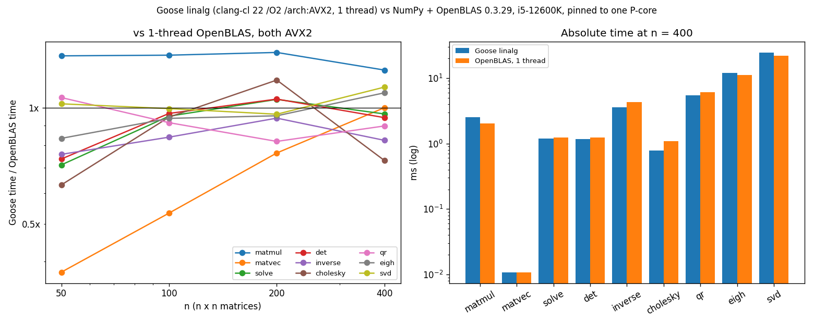
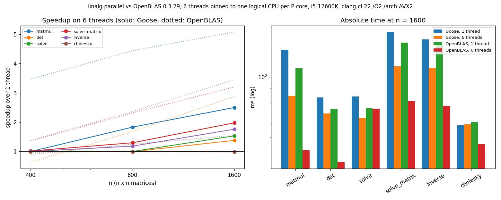

# linalg

Dense real linear algebra for [Goose](https://aardappel.github.io/goose/), in pure Goose: no C, no
build step, nothing to install. An optional module, `linalg.parallel`, runs the large products on
several threads.

```goose
import linalg from "guillochon/goose-linalg@v0.3.2";   // or from "../goose-linalg" for a local checkout

fn main() {
    let a = linalg::from_rows(3, 3, [4, 1, 2, 1, 3, 0, 2, 0, 5]);
    let x, ok = linalg::solve(a, [1, 2, 3]);
    print(a, " det ", linalg::det(a), " x ", x);
}
```

Goose fetches the package the first time a program uses it. Pin a tag, as here, or a commit
(`"guillochon/goose-linalg@<commit>"`). A branch like `@main` is pinned at whatever was fetched
first, until `goose fetch --update`.

## Conventions

- A `linalg::matrix` is `{ rows, cols, data: f64[>..] }`, row-major. Vectors are plain f64
  arrays: functions take any array kind as `f64[:]` and return `f64[>..]`.
- Functions that only **read** a matrix take an untyped parameter, so both named matrices (passed
  by reference, never copied) and temporaries work: `linalg::matmul(a, linalg::transpose(a))`.
- Functions that **change** a matrix take `matrix&`; pass a variable.
- Results are built straight into the caller's variable. Decompositions with several outputs write
  into variables you pass, LAPACK style; their previous contents don't matter:
  `var q = linalg::zeros(0, 0); var r = linalg::zeros(0, 0); linalg::qr(a, q, r);`
- To update a matrix from itself, compute into a new variable and assign a copy: `let t =
  linalg::matmul(acc, a); acc = copy(t);` (Goose builds an array's new contents in place, so
  `acc = matmul(acc, a)` is rejected.)
- Shape mismatches and out-of-range indices abort. Numerical failure (singular, not positive
  definite, rank deficient, not converged) comes back as a trailing `bool`.
- Everything is in namespace `linalg`. Goose's UFCS doesn't cross namespaces, so write
  `linalg::trace(a)`, not `a.trace()`.
- A literal's first element sets its type: `[1, 2.5]` is an integer literal and won't compile as
  `f64[:]`. Write `[1.0, 2.5]`. Literals that are all integers, like `[1, 2, 3]`, adapt to `f64`
  fine.

## API

| Area | Functions |
|---|---|
| Construction | `zeros(r, c)`, `filled(r, c, v)`, `identity(n)`, `from_rows(r, c, values)`, `diag(values)`, `random(r, c, rng)`, `clone(a)` |
| Access | `at(a, i, j)`, `set(a&, i, j, v)`, `row(a, i)` (a writable view), `col(a, j)`, `diagonal(a)`, `submatrix(a, r0, r1, c0, c1)`, `set_block(a&, r0, c0, b)`, `is_square`, `same_shape`; `print(m)` shows `[1.0 2.0; 3.0 4.0]` |
| Elementwise | `add`, `sub`, `scale(a, s)`, `hadamard`; in place: `add_assign`, `sub_assign`, `scale_assign`, `add_scaled(a&, s, b)` |
| Products | `matmul`, `matvec(a, x)`, `outer(x, y)`, `transpose`, `power(a, k)` |
| Vectors | `dot`, `vnorm` (overflow-safe), `vnorm1`, `vnorm_inf`, `vadd`, `vsub`, `vscale`, `axpy(alpha, x, y)` |
| Matrix scalars | `trace`, `norm_fro`, `norm1`, `norm_inf`, `norm2`, `max_abs`, `max_abs_diff`, `approx_equal(a, b, tol)`, `is_symmetric(a, tol)`, `cond` |
| Triangular | `solve_lower(l, b, unit_diag)`, `solve_upper(u, b)` |
| LU | `lu_factor(a&, piv&) -> sign, ok`, `lu_solve(lu, piv, b)`, `det`, `solve(a, b) -> x, ok`, `solve_matrix(a, b) -> x, ok`, `inverse(a) -> inv, ok` |
| Cholesky | `cholesky(a) -> l, ok`, `cholesky_solve(l, b)` |
| QR | `qr(a, q&, r&)` (Householder, any shape), `lstsq(a, b) -> x, ok` |
| Symmetric eigen | `eigh(a, values&, vectors&) -> converged` (divide and conquer past 64 rows, QL below; ascending; reads the upper triangle), `eigvals_sym(a)` |
| SVD | `svd(a, u&, s&, v&) -> converged` (thin, divide and conquer past 64 columns, Golub-Kahan QR below; descending), `singular_values`, `rank(a, tol)`, `pinv(a, tol)` |
| Multithreaded (`import linalg.parallel`) | `matmul_mt`, `lu_factor_mt`, `det_mt`, `solve_mt`, `solve_matrix_mt`, `inverse_mt`, `cholesky_mt`; `set_threads(n)`, `threads()`, `stop_threads()`, `parallel_jobs()` |

## Algorithms and accuracy

- `lu_factor` uses partial pivoting, blocked twice as LAPACK's `getrf`. Within an outer block of
  256 columns it factors 32-column panels, each updating the rest of the outer block with one
  matrix multiply; then the outer block updates the whole trailing matrix, 256 deep. Each panel is
  factored in a column-major copy, so its work runs down long contiguous columns: each column
  takes the updates of the columns before it four at a time, then a vectorized pivot search.
  Up to 64 columns it runs unblocked. `det`, `solve`, `solve_matrix` and `inverse` are built on it. The
  triangular solves behind `solve_matrix` and `inverse` are blocked the same two ways. `inverse`
  also skips the zeros of L⁻¹, so it costs about 2n³ flops rather than 2⅔n³.
- `cholesky` is blocked the same way, as `potrf`: 32-column panels within 256-column outer
  blocks, each level updating its trailing lower triangle with matrix multiplies. Like the LU,
  each panel is factored in a column-major copy. The trailing updates run in strips of 32 rows,
  so they compute little of the triangle above the diagonal. `cholesky_mt` keeps strips of 256
  rows, tall enough to share, and takes each strip's diagonal block in strips of 32.
- `qr` uses Householder reflections, blocked as `geqrf`/`orgqr` with the compact WY form. The 32
  reflectors of a panel combine into I − V·T·Vᵀ, so the rest of R, and later Q, take each block
  as two matrix multiplies. `lstsq` solves through QR and refuses rank-deficient input rather
  than returning garbage.
- `eigh`, past 64 rows, follows LAPACK's `dsyevd`:
  - **Reduction:** to tridiagonal form, blocked as `dsytrd`. Within each 32-column panel the
    reflectors are formed against the matrix as it stood before the panel; then the rest of the
    matrix takes the panel as matrix multiplies on its lower triangle.
  - **Divide and conquer** on the tridiagonal, as `dstedc` (Cuppen's method). Halves down to 25
    rows are solved by QL. Each merge is a diagonal plus a rank-one update: its eigenvalues are
    the roots of a secular equation, and its eigenvectors come from Gu and Eisenstat's formula,
    which keeps them orthogonal however close the roots fall. They combine with the halves'
    eigenvectors in matrix multiplies.
  - **Back to a's basis:** the reduction's reflectors are applied to the result in compact WY
    blocks.

  Up to 64 rows, `eigh` reduces with Householder reflections and diagonalizes with implicit QL
  steps and Wilkinson shifts. These are EISPACK's `tred2` and `tql2`, ported from their
  public-domain JAMA form and run on the transposed matrix so their inner loops follow rows.
- `svd`, past 64 columns, follows LAPACK's `dgesdd`:
  - **Reduction:** to bidiagonal form. It is blocked as `dgebrd` once the matrix outgrows L2
    (from 160,000 entries), and unblocked below that, where the unblocked one keeps the matrix
    in cache.
  - **Divide and conquer** on the bidiagonal, as `dbdsdc`. Each merge is a diagonal plus one
    dense row, whose squared singular values are the roots of a secular equation. That equation
    is solved with the differences of squares formed as (a − b)(a + b), so small singular
    values keep their accuracy.
  - **Back to a's basis:** the reflectors are applied in compact WY blocks.

  Up to 64 columns it uses Golub-Kahan-Reinsch: Householder reflections to bidiagonal form, then
  implicit-shift QR steps. That is LINPACK's `dsvdc` by way of JAMA, on transposed storage.
  Either way, every singular value is accurate to a small multiple of ε·σ_max. A value far below
  σ_max is therefore only accurate in absolute terms; a one-sided Jacobi SVD would also get those
  right relative to their own size.
- `svd` always returns orthonormal `u` and `v`, rank-deficient matrices included.
- Every sum goes through `dot`, which keeps 16 partial sums in a fixed array of lanes. Results are
  deterministic for a given build: the summation order is fixed in the source, not chosen by the
  compiler.

## Building for speed

`goose build` uses the C compiler it finds. On Windows with Visual Studio 2026 that is clang-cl,
ahead of MSVC; `GOOSE_CC` or `--cc` picks another. It compiles with plain `/O2` or `-O2`, which
targets baseline x86-64 (SSE2).

- **Under clang:** `linalg`'s hot kernels are `simd fn`s. Goose builds each for baseline x86-64
  and again for AVX2 and AVX-512, and picks the widest the CPU has at run time. A plain
  `goose build` therefore ran within 2% of a build with AVX2 at n = 400 and 9% at smaller sizes, and
  the matrix multiply ran at twice the speed it gets without `simd`.
- **Under MSVC:** `simd` does nothing (Goose builds one version), so enable AVX2 yourself before
  building:

  ```bash
  CL="/arch:AVX2" goose build yourprogram.goose
  ```

  With gcc or clang outside clang-cl, the equivalent is `-march=x86-64-v3`.
- **Choice of compiler:** on the test machine, clang-cl 22 with `/arch:AVX2` ran most of
  `linalg` 15–20% faster than MSVC 19.51 with `/arch:AVX2`, and `matvec` twice as fast. The
  matrix multiply ran at the same speed under both.
- **No FMA, whatever the flags:** Goose turns floating-point contraction off in the C it
  generates, so that a program's results don't depend on its compiler. So no build uses fused
  multiply-adds, and `/fp:contract` or `-ffp-contract=fast` change nothing.

Don't use `/fp:fast` or `-ffast-math`. Under clang they do bring FMA back. The disassembly
showed 2,124 vector FMA instructions against none, and the matrix multiply took 24% less time at
n = 400, at 67 GFLOP/s, ahead of OpenBLAS's 63. But they break IEEE semantics: under `/fp:fast`, MSVC folds `1.0 / 0.0` to
`1e300`, and checks for NaN and infinity stop working. One check in the test suite fails under
it. It also ends `linalg.parallel`'s bit-for-bit match with the serial results: fast-math lets
the compiler build the worker threads' copy of the kernel with a different summation order.

## Multithreading

```goose
import linalg from "guillochon/goose-linalg@v0.3.2";
import linalg.parallel;

fn main() {
    linalg::set_threads(6);                     // optional: hardware_threads() by default
    var r = rng { 1 };
    let a = linalg::random(1600, 1600, r);
    let c = linalg::matmul_mt(a, a);
    let inv, ok = linalg::inverse_mt(a);
}
```

A program that imports `linalg.parallel` contains a `thread_fn`, so it must be built with
`goose build`: the in-process `goose run` can't run threads. Programs that import only `linalg`
are unaffected.

Each `_mt` function is its serial namesake with one change: the kernel of its large matrix
products, `gemm_mt`, shares a product's rows (or columns) out between a pool of worker threads and
the calling thread. Large LU factorizations and the triangular solves after them go further (see
below). Either way the results are **bit for bit the serial ones** under IEEE floating point (not
under `/fp:fast`).

Goose threads share no memory: a worker is a separate program, and its operands and results are
copied through typed queues. On the test machine a number costs about 1.6 ns to cross a queue
(each message is a fresh allocation), so sharing a product pays only when it does enough work per
number copied. `gemm_mt` estimates both sides, and keeps any product that wouldn't pay on the
calling thread.

That limits what an LU factorization can gain from `gemm_mt`. Each 256-deep outer update would
send the whole trailing matrix out and bring it back, so the copies grow as n³ like the work
does, and adding threads never pays for them. So from n = 1100, on 3 threads or more, the LU
family factors **owner-computes** instead, as distributed-memory LAPACK (ScaLAPACK) does:
- The columns past the first outer block are dealt to the workers in 32-column blocks, and stay
  there.
- Each step, the calling thread factors the 256-column panel and sends it, with its row swaps, down
  a tree of workers. Each worker passes the panel on to two more before it starts its own columns.
- Each worker updates the next panel's columns first and sends them straight back, so the calling
  thread can factor them while the workers update the rest.

The trailing matrix never makes a round trip, so the copies grow only as n².

The triangular solves behind `solve_matrix_mt` and `inverse_mt` had the same problem through
`gemm_mt`, and have a simpler fix: every column of the right-hand sides is solved on its own. From
n = 600, the factored matrix goes once to every worker, down the same tree. The right-hand sides'
columns go out as tasks of 128 columns, and the workers and the calling thread each take the next
task as soon as they're free. `inverse_mt` sends no right-hand sides at all: each task builds its
own columns of the identity.

Goose has one queue per message type, read by every worker. A message for one worker therefore
needs a type of its own, and these owner-computes paths use at most 8 workers. The tree is the
same for every message in a call, so each worker gets every message from one sender, in order.

In practice:

- `matmul_mt` pays from about n = 500.
- The LU family (`lu_factor_mt`, `det_mt`, `solve_mt`, `solve_matrix_mt`, `inverse_mt`) factors
  owner-computes from n = 1100 on 3 threads or more. Below that, or on 2 threads, it shares its
  256-deep outer updates through `gemm_mt`, which pays from about n = 1000.
- `inverse_mt` solves owner-computes from n = 600. `solve_matrix_mt` does too, when `b` has at
  least half as many columns as rows. With fewer right-hand sides, sending every worker the
  factored matrix costs more than the solves: at n = 1600 on 6 threads, 39 ms against 4 ms serial
  for 16 columns. So narrower `b` share their products through `gemm_mt`.
- `cholesky_mt` shares the part of its outer updates left of the diagonal through `gemm_mt`. On 6
  threads it ran at serial speed up to n = 1600: the serial factorization is fast enough that
  the copies eat what sharing saves.
- Up to n = 256 the factorizations are the serial code.
- `qr`, `lstsq`, `eigh` and `svd` have no `_mt` versions. Their products are blocks of 32
  reflectors, too narrow ever to pay for the copies.

The thresholds come from 2, 3, 4 and 6 threads on the test machine:
- **Factorization:** owner-computes overtook `gemm_mt`'s LU from n = 1000 on 3 and 4 threads, and
  from n = 1100 on 6. On 2 threads it ran about 20% behind `gemm_mt` up to n = 1400, because one
  worker can't hide the serial panels.
- **Solves:** owner-computes won from n = 600 on every thread count.

An `_mt` function ran at most 4% slower than its serial version, within noise, in these runs:
- every `_mt` function at n = 400, 800 and 1600 on 6 threads;
- the LU factorization from n = 600 to 1400 on 2, 3, 4 and 6 threads;
- `solve_matrix_mt` and `inverse_mt` from n = 400 to 1000 on 2, 3, 4 and 6 threads.

The worst case was `solve_mt` at 0.96× at n = 800. Where there is enough work to share, the `_mt`
functions are faster.

On a CPU with performance and efficiency cores, set the thread count to the number of performance
cores. Call the `_mt` functions from main's thread: they share one pool and its queues, which live
in globals no worker can reach, so a `thread_fn` that calls them is a compile error rather than a
race.

## Performance

### Test setup

| | |
|---|---|
| CPU | Intel Core i5-12600K (Alder Lake). 6 performance cores with Hyper-Threading: logical CPUs 0–11, 3.7 GHz base, 4.9 GHz turbo, 48 KB L1d and 1.25 MB L2 each. 4 efficiency cores: logical CPUs 12–15, 3.6 GHz turbo, 2 MB shared L2. 20 MB shared L3. |
| Memory | 32 GB DDR5-6200 (2 × 16 GB Corsair Vengeance, CMK32GX5M2B6200C36) |
| Board | ASUS ROG STRIX Z690-I GAMING WIFI |
| OS | Windows 11 Home 23H2 (build 22631), High performance power plan |
| Goose | v2026.3, compiled by clang-cl 22.1.3 (Visual Studio 2026) with `/O2 /arch:AVX2`. A plain `goose build`, where `simd` picks the AVX2 kernels at run time, measured within 2% at n = 400 and 9% at smaller sizes. |
| Reference | NumPy 2.2.6 on Python 3.12.0, linked to OpenBLAS 0.3.29 (`DYNAMIC_ARCH`, which picks AVX2/FMA kernels on this CPU) |
| Pinning | Single-threaded runs on logical CPU 4, a performance core. Multithreaded runs use 6 threads pinned to logical CPUs 0, 2, 4, 6, 8 and 10, one per performance core. Unpinned, or on all 16 logical CPUs, OpenBLAS's LU ran more than 100× slower than on one thread. |

Every time is the best of at least three runs and 0.3 s.

### Single-threaded



On the left is the time ratio to OpenBLAS at each size; 1x means parity. On the right are
absolute times at n = 400:

| | matmul | solve | inverse | cholesky | qr | eigh | svd |
|---|---|---|---|---|---|---|---|
| Goose | 2.5 ms | 1.19 ms | 3.6 ms | 0.79 ms | 5.4 ms | 12.0 ms | 24.5 ms |
| OpenBLAS | 2.0 ms | 1.24 ms | 4.3 ms | 1.08 ms | 6.0 ms | 11.0 ms | 21.7 ms |
| ratio | 1.25× | 0.96× | 0.82× | 0.73× | 0.90× | 1.09× | 1.13× |

At n = 400:
- `solve`, `det` and `matvec` match OpenBLAS, and `inverse`, `cholesky` and `qr` beat it.
- `matmul` runs at 50 GFLOP/s against OpenBLAS's 63. It is the furthest behind, at 1.2–1.4× at
  every size, because Goose's C never uses FMA (see Building for speed).
- The middle sizes are the next gap: at n = 200, `cholesky` is 1.18× behind, and `solve` and
  `det` 1.05×. At n = 100 all three are ahead.

At n = 50, almost everything is faster than NumPy, whose call overhead dominates there.

At n = 800, `eigh` took 87 ms against OpenBLAS's 70, and `svd` 172 ms against 166. With QR
iteration instead of divide and conquer, `svd` took 436 ms.

What makes the kernels fast:
- Inner loops run over row slices with `assert`ed lengths, so Goose drops their bounds checks.
- Update loops (`ri[j] -= f * rk[j]`) then vectorize as written.
- Sums use `dot`'s lane array, the one form the C compilers vectorize without fast-math.
- The kernels are `simd fn`s, so clang builds AVX2 and AVX-512 versions of them.
- One matrix-multiply kernel, `gemm_acc`, works on blocks of matrices. It's register-blocked four
  rows of the result by four steps of the inner dimension. `matmul` is a single call to it, and
  the blocked LU, Cholesky, QR and the eigenvector/singular-vector bases do most of their work in
  it.
- Large products go through the right-hand operand in cache blocks of 128 × 512, half a megabyte
  that stays in L2, so a product bigger than the caches runs nearly as fast as one that fits.

`eigh` and `svd` follow LAPACK's divide-and-conquer drivers past 64 rows or columns (see
Algorithms). Before that, their QL and QR iterations spent over half their time on plane rotations,
and both ran about 2× behind OpenBLAS.

### Multithreaded



Times at n = 1600, and the speedups on 6 threads over 1:

| n = 1600 | matmul | det | solve | solve_matrix | inverse | cholesky |
|---|---|---|---|---|---|---|
| Goose, 1 thread | 172 ms | 67 ms | 68 ms | 244 ms | 210 ms | 38 ms |
| Goose, 6 threads | 69 ms | 48 ms | 44 ms | 123 ms | 120 ms | 39 ms |
| speedup | **2.5×** | 1.4× | 1.5× | **2.0×** | **1.8×** | 1.0× |
| OpenBLAS, 1 thread | 118 ms | 53 ms | 54 ms | 197 ms | 194 ms | 41 ms |
| OpenBLAS, 6 threads | 23 ms | 18 ms | 53 ms | 62 ms | 56 ms | 26 ms |
| speedup | 5.1× | 2.9× | 1.0× | 3.2× | 3.4× | 1.5× |

On one thread Goose is 1.1–1.45× behind OpenBLAS at this size, more than at n = 400, where the
matrices fit in cache; `cholesky` is 6% ahead. On six it is 1.5–3× behind, because OpenBLAS's
threads share the matrix in memory while Goose's copy what they work on. The exception is
`solve`, where Goose takes 17% less time: OpenBLAS doesn't speed it up on more threads at this
size.

At n = 800, `matmul` gains 1.8×, `solve_matrix` 1.30× and `inverse` 1.18×. The rest run at
serial speed.

### Reproducing

In `bench/` on Windows, with Goose on `PATH` (or `$env:GOOSE` set):

```bash
powershell -File run_pinned.ps1
```
```bash
python compare.py
```
```bash
python compare_mt.py
```

`run_pinned.ps1` builds the single-threaded benchmark three ways (plain `/O2`, production flags,
and `/fp:fast` for reference) and the multithreaded one with production flags. It runs each,
plus OpenBLAS on one and on six threads, pinned as above; `-Core`, `-Threads` and `-ThreadMask`
change the pinning for another machine.

## Tests

```bash
goose test/test_linalg.goose
```

The suite runs 1,339 checks and exits 1 on any failure. It has these kinds of checks:
- **Exact cases worked by hand:** the Hilbert inverse, a textbook Cholesky factor, Fibonacci
  through `power`, the path-graph Laplacian spectrum, and Wilkinson's W₂₁⁺, whose eigenvalues come in
  pairs that agree to about 10⁻¹⁴.
- **SVD edge cases:** matrices that force the bidiagonal QR to split and to deflate, graded
  singular values from 1 down to 10⁻¹⁵, and clustered singular values that only converge with
  the Wilkinson shift.
- **Divide and conquer:** `eigh` past 64 rows and `svd` past 64 columns, on spectra that make
  the merges deflate, rotate close pairs apart, and solve secular equations whose roots crowd
  their poles:
  - Wilkinson's W₁₀₁⁺ and W₂₀₁⁺;
  - 65 or 55 equal values, values all within 2×10⁻¹⁰, and spectra graded down to 10⁻¹⁵;
  - rank one and rank 55;
  - zeros on the tridiagonal or bidiagonal;
  - scaling by 10^±150;
  - a 420 × 390 SVD, which takes the blocked bidiagonalization.

  Each checks the residual, orthogonality and the known values within 10 n ε. The worst
  measured was 3 n ε.
- **Blocked sizes:** n = 33, 64, 97 and 300, past the 32-column panels and the 256-column
  outer blocks, for every blocked routine, with singular and indefinite matrices whose trouble
  lies past the first block; and a product past the matrix-multiply cache blocks.
- **Identities on random matrices:** checked at sizes 1–29, square, tall and wide. These cover
  `p a = l u`, `q r = a` with `q` orthogonal, `a v = v diag(w)`, `u s vᵀ = a`, the four
  Moore-Penrose conditions, `det(ab) = det(a) det(b)`, and more.

The parallel module has its own suite, which needs a native build:

```bash
goose build test/test_parallel.goose && test/test_parallel
```

Its 557 checks require every `_mt` result to equal the serial one bit for bit, at 1 to 6 threads,
through both ways of sharing a product (by rows and by columns), across a pool restart and a
resize. They also check that large products go to the pool and small ones don't. The LU family is
checked a second time with owner-computes factorization and solves switched on from n = 257, on
2, 3, 6 and 10 threads (10 is more than the 8 worker slots), and with right-hand sides too few
for every thread to get a task. After those calls, every queue must be empty: a message left
behind would be read by the next call.

Both suites pass as native builds with clang-cl 22 and MSVC 19.51, plain and with `/arch:AVX2`,
and the serial one also in-process. They were also mutation-tested: 99 bugs were planted one at a time, 78 in the library
and 21 in the parallel module, and every one was caught. They covered `gemm_acc` and its cache
blocks, the two-level LU, solves and Cholesky, the compact-WY helpers, every branch of the
Golub-Kahan iteration, `tred2`/`tql2`, the `dot` lanes, and, in the parallel module, the row and
column shares, copying results back, the cost model and the pool. Several later additions
haven't been mutation-tested yet: the owner-computes LU and triangular solves, the column-major
LU panel, the divide-and-conquer `eigh` and `svd`, and their blocked reductions.

`examples/fit.goose` fits a polynomial by least squares and finds a point cloud's principal axes.

## License

Apache-2.0, the same license as Goose itself (see `LICENSE`). The small-size symmetric eigensolver
and SVD are ports of the public-domain JAMA library's versions of EISPACK's `tred2`/`tql2` and
LINPACK's `dsvdc`. The divide-and-conquer solvers and blocked reductions follow the algorithms of
LAPACK's `dsyevd`, `dstedc`, `dgesdd`, `dbdsdc`, `dsytrd` and `dgebrd`, written afresh in Goose.
